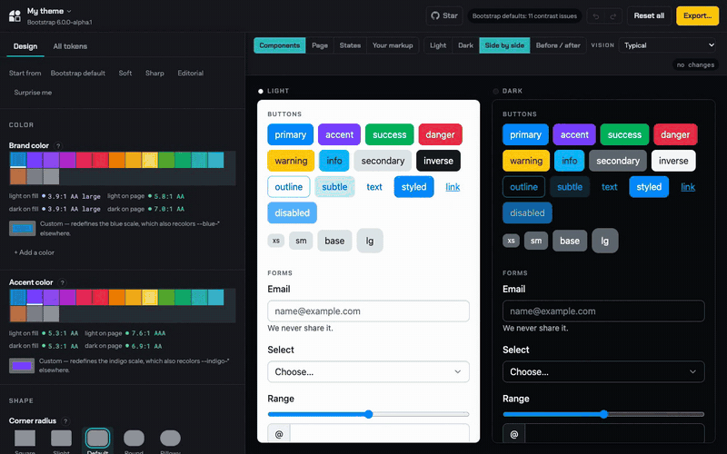

<h1 align="center"><picture><source media="(prefers-color-scheme: dark)" srcset=".github/logo-title-dark.svg"><source media="(prefers-color-scheme: light)" srcset=".github/logo-title-light.svg"></picture></h1>

<p align="center">Bootstrap 6's design system as portable design tokens — and a visual theme builder that writes them.</p>

<p align="center"><a href="https://julien-deramond.github.io/bootstrap-tokens/"><strong>Open the Theme Builder »</strong></a></p>

<p align="center">
  <a href="#quick-start">Quick start</a>
  ·
  <a href="docs/theme-builder.md">Theme Builder</a>
  ·
  <a href="docs/exports.md">Exports</a>
  ·
  <a href="docs/cli.md">CLI</a>
  ·
  <a href="https://github.com/julien-deramond/bootstrap-tokens/issues/new">Report bug</a>
</p>

<p align="center">
  <a href="LICENSE"></a>
</p>

<p align="center">
  <a href="https://julien-deramond.github.io/bootstrap-tokens/">
    
  </a>
</p>

## Table of contents

- [What this is](#what-this-is)
- [Quick start](#quick-start)
- [Status](#status)
- [What's included](#whats-included)
- [Using the tokens](#using-the-tokens)
- [Theme Builder](#theme-builder)
- [Commands](#commands)
- [Documentation](#documentation)
- [Bugs and feature requests](#bugs-and-feature-requests)
- [Contributing](#contributing)
- [Copyright and license](#copyright-and-license)

## What this is

Bootstrap 6 already has a real token system: `oklch()` color scales generated with
`color-mix()`, semantic `$theme-colors`, and a per-component `$*-tokens` map emitted as CSS
custom properties. What it does not have is that system in a **portable** form.

So this repository holds two things:

- **The tokens** — Bootstrap 6 lifted into [DTCG format](https://tr.designtokens.org/format/),
  layered primitive → semantic → component, and exported to Sass, CSS, TypeScript, Style
  Dictionary and Figma. Extracted from the released [`bootstrap@6.0.0-alpha.1`](https://www.npmjs.com/package/bootstrap/v/6.0.0-alpha.1)
  on npm, and checked back against it. A nightly job previews `twbs/bootstrap@main` against that
  release, so changes for the next alpha show up before it ships.
- **Bootstrap Theme Builder** — a local web app for designing a theme by editing those tokens,
  with real Bootstrap components re-theming beside you. It exports Sass byte-identical to what
  you would have hand-written.

```mermaid
%%{init: {"fontFamily": "ui-monospace, SFMono-Regular, Menlo, Consolas, monospace", "flowchart": {"wrappingWidth": 480}, "theme": "base", "themeVariables": {"darkMode": true, "dropShadow": "none", "background": "#0A0C11", "fontFamily": "ui-monospace, SFMono-Regular, Menlo, Consolas, monospace", "fontSize": "14px", "primaryColor": "#16181E", "primaryTextColor": "#E6E8EC", "primaryBorderColor": "#292C33", "secondaryColor": "#16181E", "tertiaryColor": "#0A0C11", "lineColor": "#3AB9BF", "textColor": "#E6E8EC", "clusterBkg": "#0A0C11", "clusterBorder": "#292C33", "titleColor": "#8F929A", "edgeLabelBackground": "#0A0C11"}}}%%
flowchart TB
  accTitle: The build, verify and sync loop
  accDescr: tokens is the DTCG source of truth. Build turns it into Sass maps, CSS custom properties and resolved JSON. Verify checks those outputs against the pinned bootstrap@6.0.0-alpha.1. Sync reads the pinned bootstrap@6.0.0-alpha.1 back into tokens.

  subgraph field[" "]
    direction TB
    tokens["tokens/ (DTCG, source of truth)"]
    outputs["Sass maps · CSS custom properties · resolved JSON"]
    bootstrap["bootstrap@6.0.0-alpha.1"]
    tokens -- build --> outputs
    outputs -- verify --> bootstrap
    bootstrap -- sync --> tokens
  end

  linkStyle default stroke-width:1.5px,color:#8F929A
  style field fill:#0A0C11,stroke:#292C33
```



> An independent project, not affiliated with or endorsed by the Bootstrap team.

## Quick start

**Design a theme** in the [Theme Builder](https://julien-deramond.github.io/bootstrap-tokens/). Nothing to
install — it runs in the browser, and every push to `main` redeploys it.

**Start a project** from a theme it exported — or skip the terminal entirely and press
*Open in StackBlitz* in the export dialog, which boots the same project in a browser tab:

```bash
npx bstokens init my-theme --theme theme.json
cd my-theme && npm install && npm run watch

npx bstokens init my-app --theme theme.json --template vite   # Vite, with Bootstrap's JS
cd my-app && npm install && npm start
```

**Or just consume the tokens** — see [using the tokens](#using-the-tokens).

The rest of the tooling reads the Bootstrap release `package.json` pins, which `npm ci`
installs into `node_modules/bootstrap`:

```bash
npm ci
```

## Status

[](https://github.com/julien-deramond/bootstrap-tokens/actions/workflows/ci.yml)

Tracks Bootstrap `6.0.0-alpha.1`. **1207 tokens**, covering all 64 of upstream's `$*-tokens`
maps.

`bstokens verify` compiles upstream's `bootstrap.scss` and the configuration exported from
these tokens, and asserts the resulting CSS is identical — today it is, across all 18253
lines. CI runs that on every push against the pinned release. A nightly job runs the same checks
against `twbs/bootstrap@main` and keeps one issue open while it differs, as advance notice for the
next alpha.

## What's included

```text
bootstrap-tokens/
├── tokens/     the token document — primitive/, semantic/, component/
├── tools/      extractor, resolver, validator, exporters, CLI
├── build/      generated exports (committed, so they are browsable)
├── web/        Bootstrap Theme Builder
└── docs/       reference documentation and maintainer notes
```

## Using the tokens

```js
import { loadTokens, themeScss, createHue } from 'bootstrap-tokens'
```
```scss
@use "bootstrap-tokens/scss";   // every Sass map, !default-flagged
```
```css
@import "bootstrap-tokens/css"; /* the flat custom-property surface */
```

`npm run build` (or `npx bstokens build`) writes every shape into `build/`:

| File | What it is |
| --- | --- |
| `scss/_tokens.scss` | every Sass map, `!default`-flagged — a drop-in starting point for Bootstrap 6 |
| `scss/bootstrap-custom.scss` | a ready-to-compile `@use "bootstrap" with (…)` configuration |
| `css/tokens.css` | the flat custom-property surface, no Sass required |
| `json/tokens.resolved.json` | every token with its `$value` resolved to CSS |
| `json/tokens.tree.json` | the document the Theme Builder loads |
| `ts/tokens.js` + `tokens.d.ts` | typed access for React and CSS-in-JS, with a union of all token paths |
| `style-dictionary/` | DTCG sources and configs, aliases intact, for pipelines that already exist |
| `figma/tokens.json` | Tokens Studio sets, flat sRGB, light and dark |

They are not one export renamed six times. Anything consumed by CSS keeps `var()` and
`color-mix()`, so a theme stays live; anything consumed by a tool with no cascade — Figma, a
chart library — is resolved to the color a browser would have painted, checked against a real
one. **[`docs/exports.md`](docs/exports.md)** covers which to reach for, how to compile
Bootstrap with your values, and what resolving cannot do.

## Theme Builder

**[julien-deramond.github.io/bootstrap-tokens](https://julien-deramond.github.io/bootstrap-tokens/)** — the
deployed build of `main`. To run it locally instead:

```bash
npm run vendor   # compile upstream Bootstrap into web/vendor/bootstrap.css (once)
npm run web      # http://localhost:4000
```

Watch real Bootstrap components re-theme in the panel beside you, then export. There is no
Sass in the browser and no compile step in the loop: v6 drives everything through CSS custom
properties, so re-declaring them is the whole mechanism.

- **Two modes over one model.** *Design* is eight controls that each move a lot of the system
  — brand color, radius, density, type, shadow. *All tokens* is all 1207, grouped and
  searchable. Both write the same overrides, so switching is lossless.
- **Light and dark side by side**, as framed artboards on a neutral canvas — a v6 theme is
  always two themes.
- **Every change is listed and revertible**, with undo throughout and a full diff of what you
  changed.
- **Contrast and color-vision checks built in**, separating problems you introduced from ones
  Bootstrap's defaults already had, exportable as a report for a pull request.
- **Themes are files.** Save, name, duplicate, share by link, reopen later — and every CLI
  command takes the same `theme.json`.

**[`docs/theme-builder.md`](docs/theme-builder.md)** is the full tour.

## Commands

```bash
npx bstokens build      # emit Sass, CSS, JSON, TypeScript, Style Dictionary and Figma
npx bstokens verify     # compile upstream vs. our export, diff the CSS
npx bstokens sync       # re-extract from Bootstrap's Sass into tokens/
npx bstokens validate   # references, cycles, layer direction, DTCG shape
npx bstokens report     # contrast and color vision, as Markdown, HTML or JSON
npx bstokens init       # scaffold a project that compiles a theme (--template sass|vite)
npx bstokens import     # read an existing custom.scss back into a theme.json
npx bstokens eject      # write the tokens into Bootstrap's own Sass sources (maintainers)
```

They read the pinned release in `node_modules/bootstrap`. Point any of them at a Bootstrap
checkout instead with `--src <path>`, `$BOOTSTRAP_SRC`, or a `bootstrap-tokens.config.json`.
Full flags and workflows: **[`docs/cli.md`](docs/cli.md)**.

## Documentation

| Document | What's in it |
| --- | --- |
| [`exports.md`](docs/exports.md) | The output shapes, which to reach for, and how to compile Bootstrap with your values |
| [`theme-builder.md`](docs/theme-builder.md) | The Theme Builder in full |
| [`cli.md`](docs/cli.md) | Every command and flag |
| [`bootstrap-v6-architecture.md`](docs/bootstrap-v6-architecture.md) | What upstream's Sass actually does |
| [`dtcg-conventions.md`](docs/dtcg-conventions.md) | The four places this deviates from the DTCG spec, and why |
| [`layers.md`](docs/layers.md) | The three layers and the reference direction |
| [`maintainer-export.md`](docs/maintainer-export.md) | `eject` — patching Bootstrap's own sources, for a pull request |
| [`token-inventory.md`](docs/token-inventory.md) | Generated token counts, refreshed by `bstokens build` |

[`PLAN.md`](docs/PLAN.md) and [`ROADMAP.md`](docs/ROADMAP.md) are the maintainer's working
notes — what's wrong and what's next, and what's done. The **nine findings about Bootstrap
itself** that this pipeline surfaced are issues labeled
[`upstream`](https://github.com/julien-deramond/bootstrap-tokens/issues?q=is%3Aissue+label%3Aupstream), each with the compile, diff or browser
measurement behind it.

## Bugs and feature requests

Open an [issue](https://github.com/julien-deramond/bootstrap-tokens/issues/new/choose). Two
kinds are especially welcome: a token whose exported value doesn't match what Bootstrap
compiles, and a configurable surface upstream has that this document doesn't model.

Every open issue is available to pick up. [`CONTRIBUTING.md`](CONTRIBUTING.md#issues) has the
labels in full, including the rules AI agents follow when they file or pick up work.

Bugs in Bootstrap itself belong at [`twbs/bootstrap`](https://github.com/twbs/bootstrap/issues).

## Contributing

See [CONTRIBUTING.md](CONTRIBUTING.md). Because `tokens/` is generated from upstream and
`build/` is committed, there are two rules worth knowing before a first pull request — both
are covered there.

## Copyright and license

Code and documentation copyright 2026 Julien Déramond, released under the
[MIT License](LICENSE) — the same license as Bootstrap.

Bootstrap is © the Bootstrap Authors, MIT-licensed; its name and logo are trademarks of its
authors, used here only to identify what this project is built for.
